  

## About

I am an Applied AI Engineer. I build and ship production AI agents for e-commerce brands: multi-agent systems that run experiments, generate catalog content and publish SEO pages on live stores, with quality gates and human approval before anything goes live.

## Focus areas

- Multi-agent systems and MCP-based tools
- LLM applications, RAG and AI evaluation
- Agent reliability: quality gates, guardrails and human approval
- Experimentation, personalization and generative commerce

## AI stack

- **Agents:** LLM tool calling, multi-agent orchestration, MCP, human-in-the-loop workflows, browser-automation agents
- **Retrieval:** RAG pipelines, embeddings, vector databases (Pinecone, Qdrant)
- **Quality and safety:** evaluation, quality gates before publish, structured outputs (JSON Schema), approval flows
- **Frameworks and models:** LangChain, n8n, Gemini API, TensorFlow.js

## Selected projects

| Project | What it does |
| --- | --- |
| [face_forward](https://github.com/Gibrail404/face_forward) | Face-recognition employee attendance with anti-spoofing. Office hackathon winner. |
| [SmartLeads-AI_CRM](https://github.com/Gibrail404/SmartLeads-AI_CRM) | AI-powered CRM with Gemini lead scoring, analytics dashboard and CI/CD. |

## Writing

- [Why an AI Agent Should Never Say "Done" Until It Has Checked](https://medium.com/@gibrailzaidi/why-an-ai-agent-should-never-say-done-until-it-has-checked-b7a6f9748ed5)

## Connect

[LinkedIn](https://www.linkedin.com/in/gibrailzaidi/) | [Medium](https://medium.com/@gibrailzaidi) | gibrailzaidi@gmail.com
